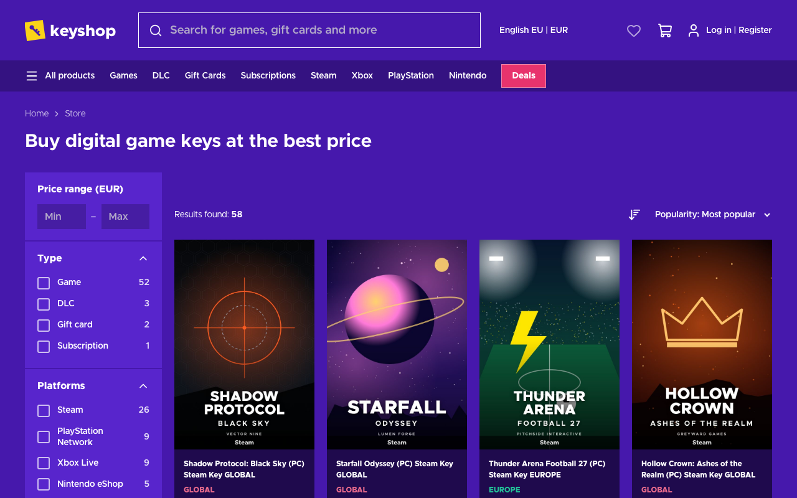
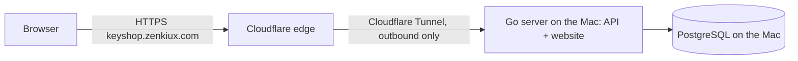

# keyshop — an Eneba-style digital key marketplace

Submission for the **Eneba Intern Assignment 2027**: a marketplace web app in Eneba's style where visitors browse and search games, compare offers from several sellers, add a chosen offer to the cart, sign in, pay (simulated) and receive the digital key they bought.

| | |
|---|---|
| **Live app** | **https://keyshop.zenkiux.com** |
| **Demo account** | `demo@example.test` / `demo-password-2027` (or create your own) |
| **AI conversation history** | [docs/agent-chat-history.md](docs/agent-chat-history.md) (Claude Code, complete) · ChatGPT planning chat: https://chatgpt.com/share/6afb8cee-cbcc-83ed-b0cd-8dc72839ec88 |

> All games, studios, sellers, ratings and keys are **fictional demo data**. Payment is simulated: **no real money is involved**. This is a student project and is not affiliated with Eneba.



## What it does

The full purchase flow from the assignment's diagram — **Homepage or Search → Product page → Cart → Checkout (sign-in required) → Payment → Order and key** — works end to end and is covered by browser tests.

| Part (from the PDF) | What's implemented |
|---|---|
| **Store** | Every product in the database, paginated; server-side filters (platform, region, product type, price range) with live result counts; 8 sort orders; search by name; filters, sort and page kept in the URL. |
| **Homepage** | Built entirely from the backend: `GET /api/home` returns which blocks to show and in which order (a database table), and each block loads its own content from its own provider — banners, categories, best sellers (from paid orders), deals (from prices), new releases, upcoming. Changing database rows changes the page with no frontend change (tested). |
| **Search** | Header search on every page with suggestions; tolerant of typos and partial names (PostgreSQL `pg_trgm`), ranked exact → prefix → substring → similarity. "starfal odysey", "kingdm forge" and "neon drfit" all find the right game. |
| **Product page** | Product details and every seller's offer (price, stock, rating) to compare; buy the exact offer you choose — the order keeps that seller and price. |
| **Checkout** | Guest cart in the browser, server cart after sign-in (merged); checkout reserves one key per unit for 15 minutes; demo payment with *success* and *decline*; keys delivered on the order page and kept in order history. Safe under concurrency and retries (see below). |
| **Authentication** | Register, log in, log out. Checkout and order history require sign-in, enforced by the API. |
| **Eneba styling** | Colours, typography (Metropolis), spacing and components measured on eneba.com and applied as design tokens; checked by side-by-side screenshot reviews at desktop and mobile widths. |

## Tech stack

- **Frontend:** React 19 + TypeScript (strict), Vite, React Router, TanStack Query, CSS Modules with design tokens.
- **Backend:** Go (standard library HTTP router), REST/JSON, `pgx`, `goose` migrations, `bcrypt`.
- **Database:** PostgreSQL 16 (`pg_trgm`, `citext`).
- **Tests:** Go integration tests on real PostgreSQL, Vitest, Playwright.
- **Hosting:** a Mac that stays on runs the Go server (API + built website) and PostgreSQL as background services; **Cloudflare Tunnel** (free plan) publishes it at `keyshop.zenkiux.com` over HTTPS. Free cloud alternative (Vercel → Render → Neon) is ready in the repo (`web/vercel.json`, `render.yaml`).

## Architecture



The Go server serves both the website and `/api` from one origin, so the session cookie is first-party and no CORS is needed. It listens only on `127.0.0.1`; the tunnel makes an outbound connection to Cloudflare, so no port is opened on the home network. The Go service is a **modular monolith**: `catalog`, `home`, `auth`, `cart`, `orders` modules, each with handler → service → SQL. Details: [docs/architecture.md](docs/architecture.md).

**How keys are kept consistent.** Every key is a database row with a status (`available`, `reserved`, `sold`) and a link to the order item that holds it; a `CHECK` constraint ties the two together. Checkout reserves keys with `SELECT … FOR UPDATE SKIP LOCKED`, all lines or none; every transaction takes locks in the same order (orders → offers → keys) so they can't deadlock; order creation and payment are idempotent (`Idempotency-Key`), so double clicks and retries can't create duplicates; unpaid reservations expire after 15 minutes and are swept back into stock. Tests include 50 buyers racing for 3 keys, concurrent duplicate requests, an injected failure mid-transaction and a mixed-operation stress run, each followed by an invariant check.

**Security.** bcrypt passwords; random session tokens stored hashed, in an `HttpOnly`, `SameSite=Lax`, `__Host-` cookie; Go's cross-origin protection on all state-changing requests plus JSON-only bodies; rate-limited login; every order/cart query scoped to the signed-in user (other users' ids return 404); keys encrypted at rest (AES-256-GCM) and only returned to the owner of a paid order.

## Run locally

Requirements: Go 1.25+, Node 22+, PostgreSQL 16 running locally.

```bash
make db        # create databases "eneba" and "eneba_test"
make seed      # apply migrations and load the demo data (idempotent)
make api       # API on http://localhost:8080
make web       # app on http://localhost:5173 (proxies /api to :8080)
```

`make seed ARGS=-reset` wipes and reloads the demo data. First `cd web && npm install` (and `cd e2e && npm install && npx playwright install chromium` for browser tests).

### Configuration

The API reads environment variables (see [api/.env.example](api/.env.example)); development needs none of them.

| Variable | Purpose |
|---|---|
| `APP_ENV` | `dev` or `prod` (prod requires the two below and enables `__Host-` secure cookies) |
| `DATABASE_URL` | PostgreSQL connection string |
| `KEY_ENCRYPTION_KEY` | 32 random bytes, base64 (`openssl rand -base64 32`), encrypts stored keys |
| `TRUSTED_ORIGINS` | Comma-separated origins allowed to send POST/PUT/DELETE |
| `SEED_IF_EMPTY` | `true` to load demo data on first boot when the catalog is empty |

Migrations are embedded in the binary and applied on start.

## Tests

```bash
make test                                   # Go vet + tests, frontend typecheck/lint/tests
cd e2e && npx playwright test               # browser tests (start the API and web first)
BASE_URL=https://<deployed-app> npx playwright test   # same tests against production
```

- **Go:** catalog (filters vs independent SQL counts, every product reachable under all sorts, search matrix), homepage (database changes change output), auth (cookies, expiry, cross-site, rate limit), cart (stock, isolation, merge), orders (concurrency, idempotency, expiry, fault injection, invariants). Each test runs on its own clone of a seeded database.
- **Playwright:** the purchase journey from the homepage and from a typo search, choosing a non-cheapest seller; decline then success; key in order history; sign-in redirects; store URL state; mobile; design tokens; homepage driven by the database.
- Results and bugs found along the way: [docs/testing.md](docs/testing.md).

## Scope decisions and known limitations

Depth went into the required purchase journey; wishlists, reviews, cashback, social login, e-mail delivery, a seller dashboard and an admin UI were left out on purpose — reasons in [docs/scope-decisions.md](docs/scope-decisions.md).

- **Availability depends on the host Mac** (power, network). Services restart automatically at login and after crashes; the free cloud setup in the repo is the fallback. (The client still retries if the API is briefly unreachable.)
- **Simulated payment** — chosen deliberately (the PDF allows it); the order/payment lifecycle on the server is real.
- **Rate limiting is in memory** (single instance, best effort).
- **Cart, checkout and order pages** have no Eneba reference screenshots (they need an account and items); they reuse Eneba's measured components.
- **Images** in the default catalog are original generated artwork; no third-party game art or logos are used ([credits](web/public/assets-credits.md)).
- **Optional "Eneba catalog" switch** (off by default, in the category bar): shows a one-off snapshot of eneba.com listings — real titles, covers (loaded from Eneba's image CDN) and prices — for the interview demo, with a visible "demonstration only" banner. The snapshot is imported from a local file that is not in this repository; sellers stay demo sellers and keys stay fake. See decision 23 in [docs/decisions.md](docs/decisions.md).

## How AI was used

This project was built with **Claude Code** (agentic coding) after planning the approach with **ChatGPT**:

1. ChatGPT analysed the assignment and wrote the initial planning prompt (the first message in the Claude transcript) and later reviewed the first version of the plan.
2. Claude Code read the PDF, inspected eneba.com in a browser to measure its design, wrote the requirement matrix and plan, and — after my approval and corrections — implemented the app milestone by milestone: backend, tests, frontend, visual reviews.
3. I reviewed every milestone, made the product decisions (scope, images, hosting, deadline handling) and steered changes; corrections I made are visible in the transcript.

The complete, unedited Claude Code conversation (prompts, replies, tool calls and results) is in [docs/agent-chat-history.md](docs/agent-chat-history.md). It is exported from Claude Code's session files and checked block-by-block against them by [`scripts/transcripts/transcripts.py`](scripts/transcripts/transcripts.py). Details: [docs/agent-logging-plan.md](docs/agent-logging-plan.md).
